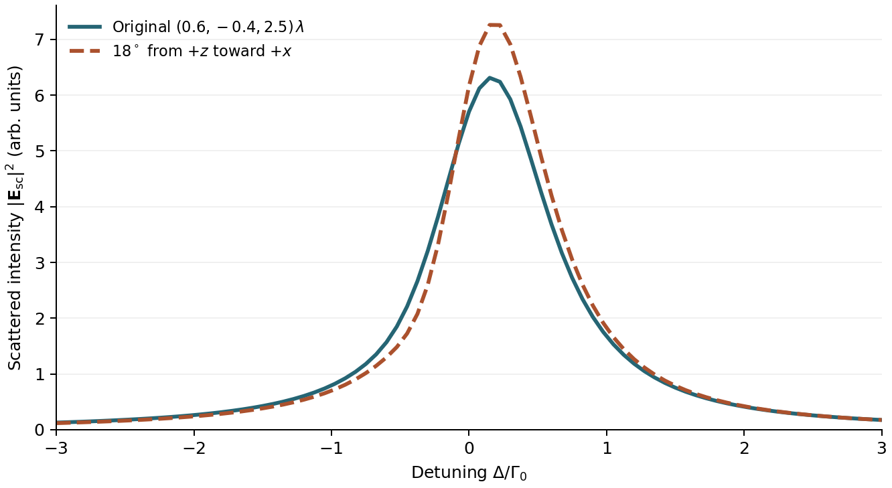

## Detector spectrum of a sparse dipole array {#coupled-dipole-spectrum}

A local drive excites one site of a $320\times320$ square array. At each of 81 detunings we solve $(A+\Delta I)x=b$ for all 102,400 dipole amplitudes and sum their electric fields at two detectors at the same distance from the driven site. ShiftedGMRES.jl shares one Arnoldi basis across the detunings in each restart cycle.

{fig-alt="Two detector spectra for a 320 by 320 array, including a detector tilted 18 degrees from the array normal toward the dipole axis."}

[Original detector (CSV)](files/sparse-array-detector.csv){.text-link} · [18° detector (CSV)](files/sparse-array-detector-xz.csv){.text-link} · [Solver and runnable example (ZIP)](files/ShiftedGMRES-0.1.3.zip){.text-link} · [FreeSpaceGreens.jl (ZIP)](files/FreeSpaceGreens-0.1.0.zip){.text-link}

### What makes the matrix sparse?

The example models coherent exchange along the four nearest-neighbor bonds of each interior site, with open boundaries and local coherence damping $\Gamma_0/2$. This choice gives **510,720 nonzero entries**. A full free-space dipole interaction couples every pair and gives a dense matrix. The lattice spacing is $0.35\lambda$, all dipoles point along $x$, and the bond strengths are the real parts of the free-space couplings for the two bond orientations. Frequencies are in units of the single-emitter population decay rate $\Gamma_0$.

```julia
Jx = real(hybrid_coupling([spacing, 0., 0.], dipole, dipole; k))
Jy = real(hybrid_coupling([0., spacing, 0.], dipole, dipole; k))
bonds = spdiagm(-1 => ones(side-1), 1 => ones(side-1))
unit = spdiagm(0 => ones(side))
A = 0.5im*I - Jx*kron(unit, bonds) - Jy*kron(bonds, unit)
result = shifted_gmres(A, drive, detunings; restart=24, rtol=1e-9)
```

### From amplitudes to the detector field

The driven site is at the origin. The first detector is at $\mathbf R_1=(0.6,-0.4,2.5)\lambda$. The second is tilted by $\pi/10$ from $+z$ toward $+x$ in the $xz$ plane, at $\mathbf R_2=|\mathbf R_1|(\sin(\pi/10),0,\cos(\pi/10))$. Changing the detector only changes the field readout. Both spectra use the same solved dipole amplitudes.

For each detector, each column of its three-row matrix maps one $x$-polarized source to its full finite-distance electric field. Stacking the two matrices lets one multiplication give all three components at both detectors across the scan. The plotted intensity is $|\mathbf E_{\rm sc}|^2$ in arbitrary units. Each CSV also gives the real and imaginary parts of the three components.

```julia
original = [0.6, -0.4, 2.5]
tilted = norm(original) * [sinpi(1/10), 0.0, cospi(1/10)]
detectors = (original, tilted)
# After filling the two three-row blocks with green_tensor(R - source; k) * dipole:
E = reshape(to_detectors * result.X, 3, length(detectors), :)
intensity = dropdims(sum(abs2, E; dims=1); dims=1)
```

The sweep took 48 shared Arnoldi steps. The largest relative residual over all 81 systems was $1.53\times10^{-11}$. At $\Delta/\Gamma_0=-3,\,0,\,+3$, separate sparse LU solves agreed with the dipole amplitudes, complex fields, and intensities at both detectors to relative tolerance $10^{-8}$.

### Run the scan

Extract both ZIP files into one empty directory and start Julia there. The example prints the shared iteration count, solve time, maximum residual, and on-resonance field and intensity. The timed section covers the shifted solve after compilation. It excludes matrix assembly, detector propagation, and the three reference solves.

```julia
pushfirst!(LOAD_PATH, pwd())
include("ShiftedGMRES.jl/examples/sparse_dipole_array.jl")
```
